# Quorum

**Your AI team. One conversation. One goal.**

[](https://perdieminc.github.io/Quorum/)
[](https://github.com/PerDiemInc/Quorum)
[](https://github.com/PerDiemInc/Quorum/actions/workflows/ci.yml)

A standalone local-first meeting prototype. Create specialist agents with their own instructions, multiple Markdown skills and model configuration, invite them to a goal-oriented meeting, and let them discuss until you accept the outcome.

## Screenshots

These use a made-up demo meeting with real model replies.

### The meeting room


| | |
|---|---|
| 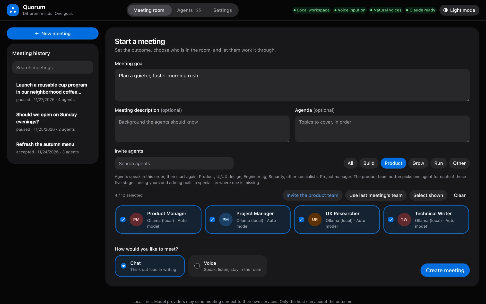 | 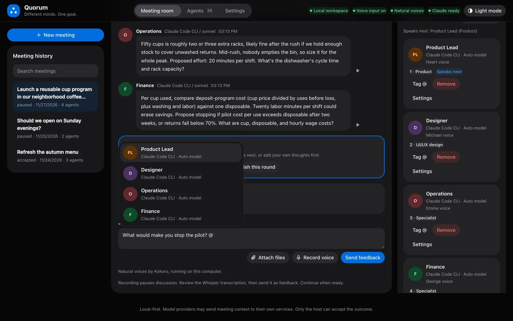 |
| **Invite the room.** Write a goal and filter agents by group. | **Tag with @.** Ask specific agents to answer. |
| 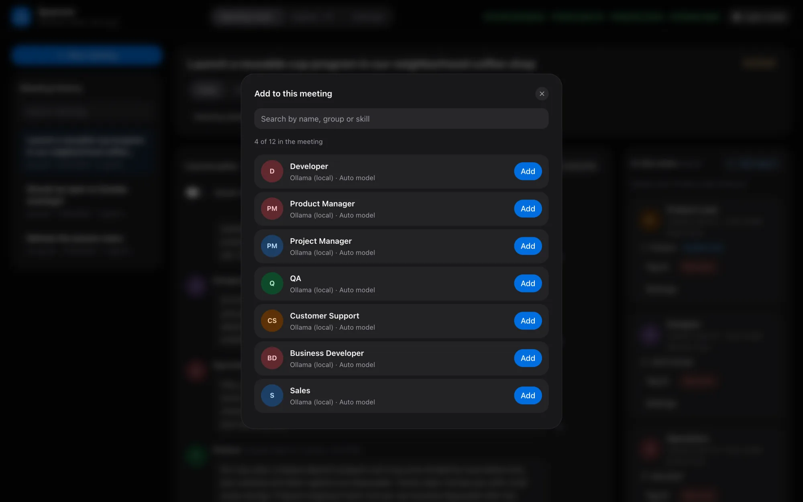 |  |
| **Add or remove agents** while the discussion runs. | **Talk it out** in a voice room. |

### From discussion to code

Four agents (Product Manager, Designer, Developer and CISO) took this goal round the room, built a one-page site and committed it as they wrote. The replies and files are real model output; the repository `acme/site` is a stand-in on the local machine, so nothing was sent to GitHub.

| | |
|---|---|
| 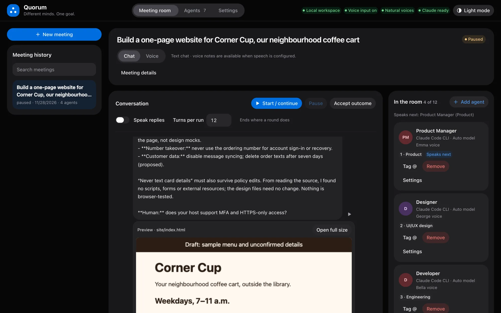 | 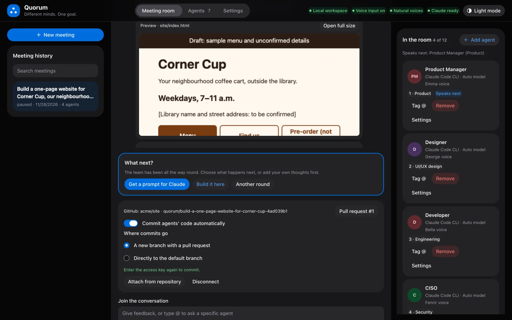 |
| **Agents speak in order,** and each design shows as a live preview. | **Choose what happens next** after a round. |
| 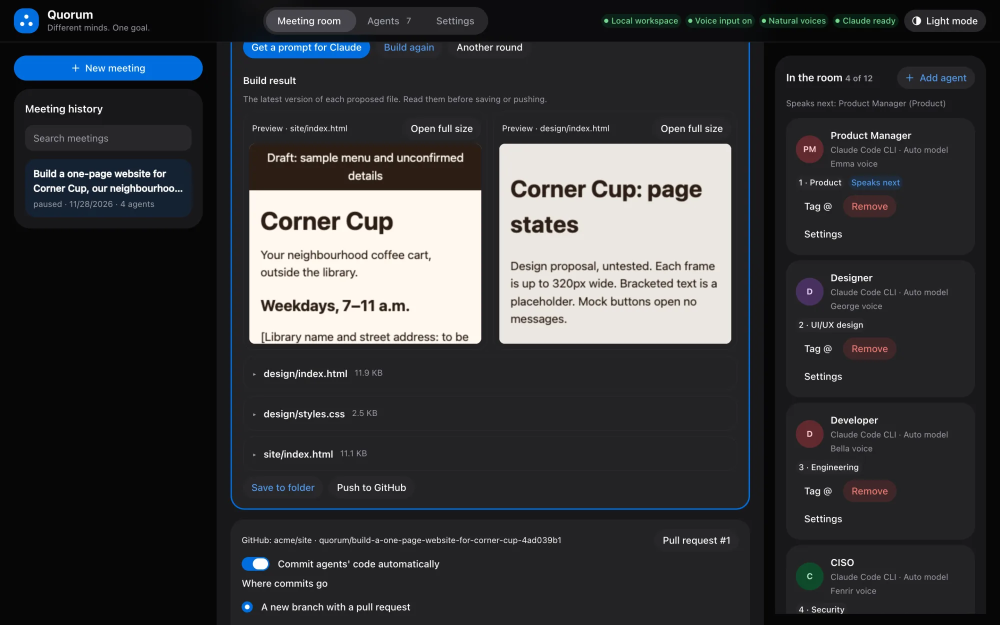 | 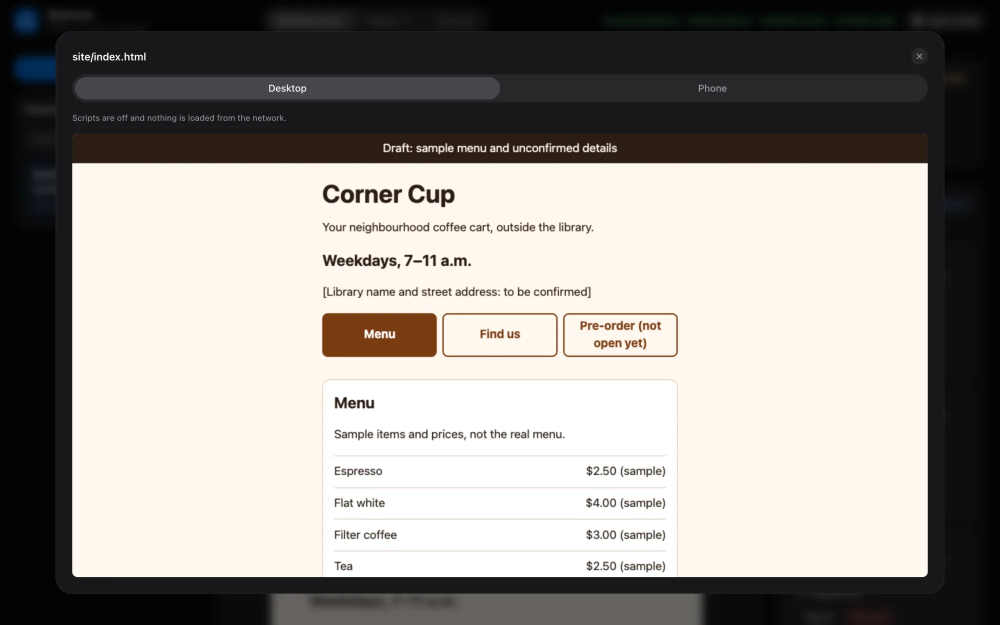 |
| **Build it here** and review the files. | **See the design** at desktop or phone width. |
| 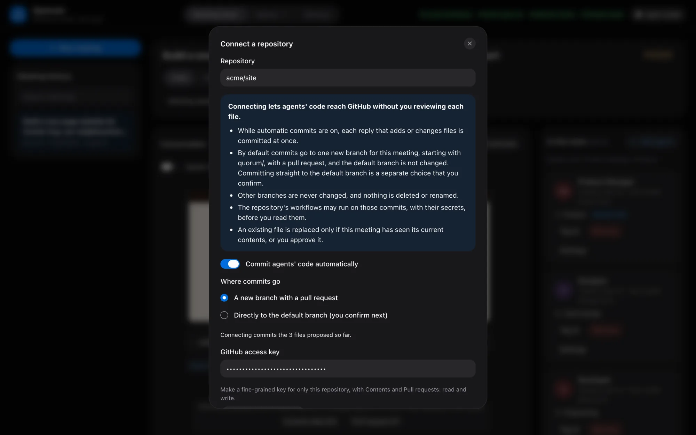 | 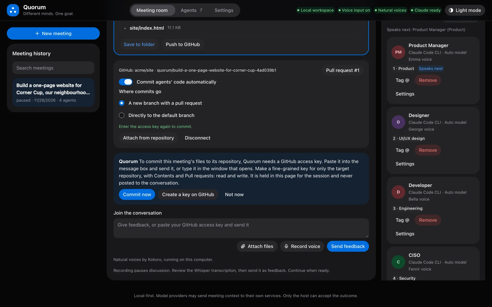 |
| **Connect a repository** and read what that allows. | **Give an access key** that stays in the open page. |
| 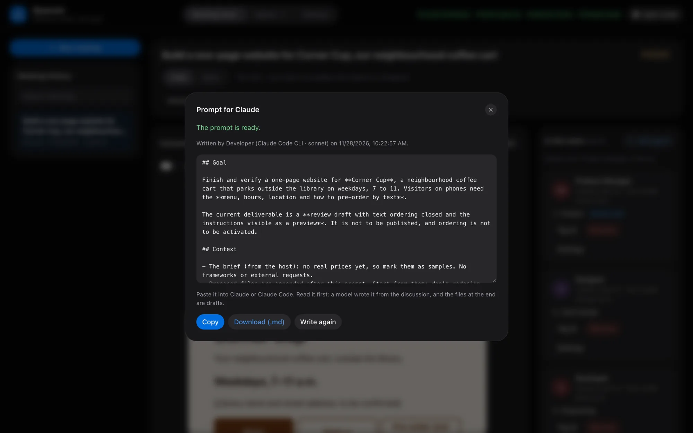 | 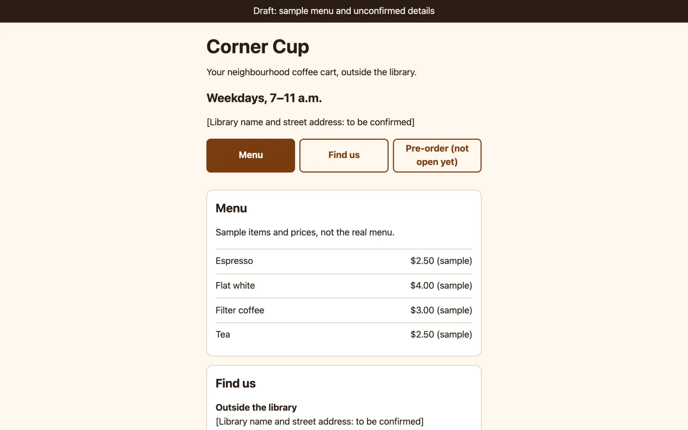 |
| **Or take a prompt** to Claude or Claude Code. | **The page the four agents built.** |

### Agents and skills

| | |
|---|---|
|  |  |
| **22 specialists** in four groups. | **Import from GitHub.** Preview, then add. |
| 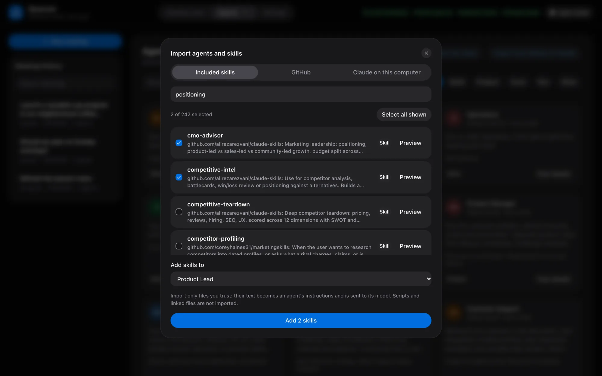 | 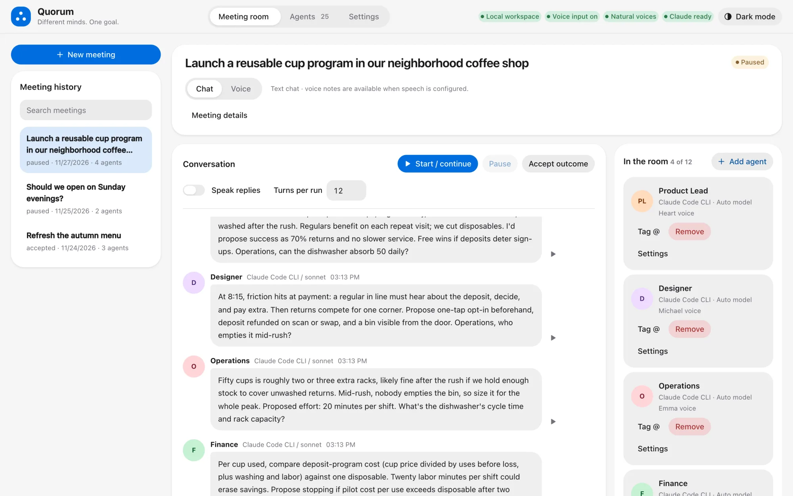 |
| **Included skills** you can add to any agent. | **Light mode**, when you want it. |

### On a narrow screen

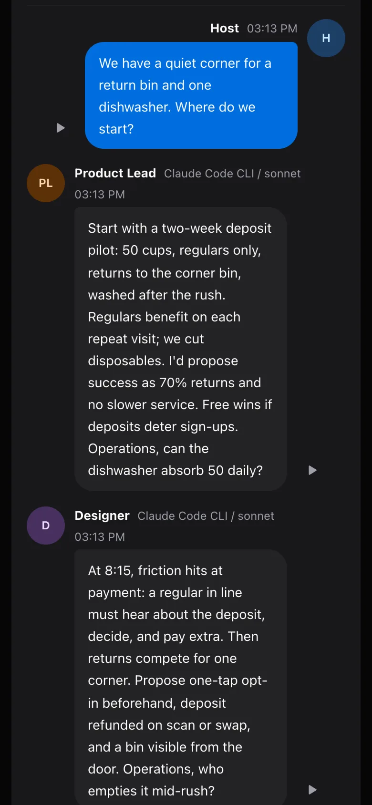

## Website

**<https://perdieminc.github.io/Quorum/>**

[docs/index.html](docs/index.html) is a one-page site for Quorum. Scrolling drives its animation: the demo meeting passes from speaker to speaker, the app screens rise and change, and the demo plays as audio in each agent's voice. Each animated section shows where you are and offers a way past it, and the animation can be turned off on the page. With reduced motion turned on in your system it is a plain scrolling page. GitHub Pages publishes it from the `docs` folder of `master`.

## Docker quick start (recommended)

Requirements: Docker Desktop with Compose; allow at least 6 GB RAM for the small default models. Larger models need more memory and disk. The app image includes Node 24; the Mac's Node version does not matter for Docker.

```bash
git clone https://github.com/PerDiemInc/Quorum.git
cd Quorum
cp .env.example .env
docker compose up -d --build
# One-time model download; alternatively use Settings → Download model.
docker compose exec ollama ollama pull qwen2.5:0.5b
```

Open http://127.0.0.1:4710. If another app uses that port, set `QUORUM_PORT=4711` in `.env` and run Compose again. The app accepts only loopback Host headers and same-origin mutations even though its container listens on `0.0.0.0`. Only the app port is published, bound to **127.0.0.1**. Inference services stay on the private Compose network; the app uses `ollama`, `inference`, and `whisper` service DNS names.

Create an agent using **Ollama (local)**, invite it to a meeting, then start the discussion. The built-in Architect and Critic are explicitly labeled demo agents. They do not call an AI model.

### Automatic model selection

Leave an agent's model blank (the default) and Quorum picks one on every turn. The transcript shows the model that answered.

| Provider | Automatic choice |
|---|---|
| Ollama | The largest installed local chat model up to 8 GB, otherwise the smallest. Embedding and cloud models are skipped. |
| OpenAI-compatible | The first non-embedding model the endpoint lists. |
| Claude Code | `sonnet` |
| ChatGPT / Codex | `gpt-6.2-sol` |

Typing a model name pins it. A pinned Ollama model that is no longer installed falls back to the automatic choice. Changing an agent's provider resets it to automatic.

### Dashboard

- **Meeting room:** set a goal, add an optional description and agenda, invite agents, reuse the last team or invite the [product team](#speaking-order), attach files, run or pause turns, add feedback, and accept the outcome yourself. **Add agent** brings another one in and **Remove** on a card drops one, at any point before acceptance, even mid-discussion. A newcomer sees the recent conversation and takes its place in the [speaking order](#speaking-order); a removed agent's unfinished reply is discarded and can be added back with the settings it had. Earlier messages and the agent library are kept. A meeting has between 1 and 12 agents. Once the team has been round, Quorum asks [what next](#what-next-a-prompt-for-claude-or-build-it-here). Agents can [propose files](#files-the-workspace-folder-and-github) for you to save or push, or have [committed as they write](#committing-as-agents-write).
- **Meeting history:** search by goal, description, agenda, or agent. Reopen a saved room to see its context, participant snapshots, and transcript.
- **Agents:** create specialists, inspect instructions/skills/model/voice, delete from the library, or restore the most recently deleted agent. Existing meetings retain independent participant snapshots. Deleted agents are retained in SQLite for restoration.
- **Settings:** list installed Ollama and compatible endpoint models, check provider access, and install an Ollama model by name. Downloads show progress and errors and survive page navigation. One download runs at a time. If the app restarts, run the pull again; Ollama reuses already downloaded layers. A healthy Ollama process does not imply that any model has been pulled.

### Storage and lifecycle

Named volumes preserve SQLite state and the workspace folder (`quorum-data`), Ollama weights (`ollama-models`), optional Hugging Face GGUF downloads (`hf-models`), and optional speech weights (`whisper-models`). The app runs as a non-root user with a read-only root filesystem and a writable `/data` volume. No Docker socket or host credentials are mounted.

```bash
docker compose ps                         # Health status
docker compose logs --tail 100 quorum     # App logs
docker compose down                      # Stop; retain all data/models
docker compose up -d --build              # Rebuild/restart; retain data/models
```

**Do not use `docker compose down -v` unless you intend to delete stored meetings, agents, and model volumes.** Back up the SQLite volume while the app is stopped before resetting it.

### Apple Silicon

Ollama and llama.cpp inside ordinary Linux containers on macOS use the CPU, not Apple's Metal GPU. These Compose services do not request GPU passthrough. Small quantized models work for smoke tests; large models can be slow. See [Ollama's Docker guidance](https://docs.ollama.com/docker). Native macOS Ollama can use Metal, but is a separate deployment choice from this container-first setup.

### Optional Hugging Face inference

```bash
docker compose --profile hf up -d --build
```

This builds a CPU llama.cpp server from a pinned upstream revision, supporting ARM64 and x86 without relying on a registry-hosted server image. The first build and model download take time. The default is Qwen2.5 0.5B Instruct GGUF; override `HF_MODEL_REPO` and `HF_MODEL_FILE` in `.env` for another compatible model. Read its model license before choosing a model for your use. Create an agent with **OpenAI-compatible / Hugging Face** and model `local-hf`. The app uses `http://inference:8080/v1`; the model is downloaded once into its volume. Check `docker compose logs inference` and wait for its health check before using it. Gated model authentication is not configured by this example.

### Optional speech container

Set `WHISPER_URL=http://whisper:8000/v1` in `.env`, then:

```bash
docker compose --profile speech up -d --build
```

The CPU faster-whisper container exposes an OpenAI-compatible transcription endpoint internally. The first transcription downloads `Systran/faster-whisper-tiny.en` into its model cache. Set `WHISPER_REMOTE_MODEL=Systran/faster-whisper-base` for multilingual recognition. Microphone capture still requires browser permission; use loopback HTTP or a secure context. The health check verifies the service, not a completed model download. The app reports transcription errors if the model cannot load.

Speech output uses local browser voices by default. Kokoro remains supported through `KOKORO_URL` in native installs or an explicitly configured compatible service, but is not included in this ARM64 Compose setup. Recording is push-to-talk, not continuous voice activity detection. Optional profiles can run together with `--profile hf --profile speech`.

### Mac Claude Code / Codex access

Docker cannot automatically execute the Mac's CLI binaries or use its login. Settings checks executable presence and authentication in the **app's runtime**, and separately displays an optional timestamped host snapshot:

```bash
npm run check:host
```

Run this on the Mac, not inside Docker. It writes only capability booleans, CLI versions, and the check time into `.quorum/host/access.json`, which is mounted read-only. Re-run after installing a CLI or changing login. Host detection does **not** grant container access. Authentication status is not a guarantee of model entitlement or a successful model call. The check does not issue paid inference requests.

To use host CLIs without the bridge described below, run Quorum natively with Node 24+ and `QUORUM_ENABLE_CLI=1 npm start` (choose a different `PORT` if Docker is running). Install and authenticate `claude` and `codex` first. Their automatic model can be overridden per agent; CLI authentication does not expose a reliable catalog of entitled models. CLI providers generally use cloud inference.

### Validation

```bash
# Native Node 24+:
npm ci && npm run typecheck
npm test
# Smoke test against running Docker app, after pulling qwen2.5:0.5b:
QUORUM_URL=http://127.0.0.1:4710 npm run smoke
# Run tests without installing Node 24 on the host:
docker run --rm -v "$PWD:/app:ro" -w /app node:24-alpine npm test
```

The smoke test checks app health, origin rejection, model discovery, and an actual Ollama response without modifying agents or meetings. Automated tests cover download errors/concurrency, speech request formatting, Host/Origin restrictions, SQLite persistence across server restart, speaking order and rounds, file extraction and path safety, preview isolation, the prompt for Claude, key removal, and pushing and committing against a mocked GitHub API.

## Run on this Mac with the Docker model services

The server runs natively, so it uses your Claude Code and Codex logins directly (no bridge), while Ollama, llama.cpp and Whisper stay in Docker:

```bash
docker compose stop quorum   # frees port 4711
npm run services             # model services, published on loopback only
npm run start:local          # http://127.0.0.1:4711
```

This needs Node 24+ and Docker; the first run of `npm run services` builds or downloads any missing images. Native data lives in `.quorum/quorum.sqlite`, separate from the Docker `quorum-data` volume. To bring existing data over, stop the `quorum` service and, only if that file does not exist yet, run `docker compose cp quorum:/data/. .quorum/`. To go back to Docker, stop the native server and run `docker compose up -d quorum`; changes made natively are not copied back.

The header shows **Claude ready**, **Claude disabled** or **Claude unavailable**. Claude runs in safe mode (none of your CLAUDE.md, skills, plugins or hooks) with no tools and no saved sessions; set `CLAUDE_BIN` if it is not on the PATH. Each message has a play button that reads it aloud (press again to stop). Playing a message pauses the discussion if **Speak replies** is on.

New agents start on Claude, Codex or Ollama (the first that is connected) with an [automatic model](#automatic-model-selection). With the app running, `npm run check:models` sends one short request to each model in use and to the speech services, and exits non-zero if any fail (set `QUORUM_URL` for a different address). Claude and Codex requests may count against your plan.

The interface is dark by default; **Light mode** in the top bar switches it.

`npm run services` also starts [Kokoro](https://huggingface.co/hexgrad/Kokoro-82M), a neural voice model, when there is a local image with `kokoro-onnx` and its model files in `/app/tts-models` (`ai-models:cpu` by default; set `KOKORO_IMAGE` for another). It is not downloaded for you; without it, Quorum reads with your browser's voices. Every agent gets its own voice, which you can change on its card in a meeting; your messages use a separate one. Markdown symbols are removed before speaking.

## Native quick start

Node.js 24+ is required (built-in SQLite); running the app needs no npm dependencies. Run `npm start`, then open http://127.0.0.1:4710. State is stored in `.quorum/quorum.sqlite` unless `QUORUM_DATA` is set. Container data lives in a separate Docker volume and is not automatically copied from an existing native checkout.

## Models

- **Ollama:** start Ollama, pull a model (e.g. `ollama pull qwen3:8b`) and create an agent with provider Ollama; the model is chosen automatically. Default endpoint: http://127.0.0.1:11434.
- **Hugging Face / local models:** serve a downloaded compatible model through llama.cpp, LM Studio, vLLM or another OpenAI-compatible chat server. Set `QUORUM_OPENAI_URL=http://127.0.0.1:8080/v1` and use its model identifier.
- **Claude Code / Codex:** install and authenticate the respective CLI yourself, then start with `QUORUM_ENABLE_CLI=1 npm start`. Leave the model blank for the automatic choice, or type a supported model name. These clients usually use cloud inference, not offline inference. Claude receives an empty tool list and empty MCP configuration; Codex uses its read-only sandbox. These settings are not a complete isolation boundary: installed CLI configuration, integrations and read access may still apply. Enable only for trusted agents and skills.
- **Other endpoints:** an OpenAI-compatible provider can use a deliberately configured remote URL and optional `QUORUM_OPENAI_KEY`. This sends conversation and assigned instructions to that service.

## Speaking order

Agents speak by stage, then start again: **Product → UI/UX design → Engineering → Security → other specialists → Project manager**. A stage comes from the agent's name, with the most specific role first: a Project Manager is the project manager, a Product Designer is design, a Security Engineer is security, and QA, Business Developer and anyone unrelated are other specialists. For a name that says nothing, a group such as "Security" or "Design" decides; the built-in groups do not. Agents of one stage keep the order they joined in.

Each card in the room shows the agent's position and stage, and who speaks next. Every agent is told the order, builds on the stage before it, and has a short brief: product covers the user, problem, scope and acceptance criteria; design the interface and design files; engineering the plan and code; security the risks and their fixes; the project manager decisions, owners, next steps and whether it is ready to build. An agent added mid-meeting speaks next if its place falls between the last speaker and the next one. Meetings from earlier versions that are not accepted are put in this order once, without changing whose turn it is.

**Invite the product team** on the new-meeting form selects one agent for each of the five stages. It uses your agents first (demo agents do not count) and adds the built-in Product Manager, Designer, Developer, CISO or Project Manager where you have none, on your connected provider.

A **round** is complete when every stage in the room has spoken, ending with the last. Until you change **Turns per run**, a run ends where a round does: with five agents the default of 12 gives two rounds. A number you set is used exactly.

## What next: a prompt for Claude, or build it here

After a full round, a **What next?** card appears and stays available, with **Another round** and:

- **Get a prompt for Claude.** The engineering agent's model (else the project manager's, else the first agent's) writes a self-contained prompt to paste into Claude or Claude Code: goal, context, decisions, requirements, design direction, constraints and security points, and acceptance criteria. Quorum itself appends the current version of every proposed file, whole, up to 200,000 characters; larger ones are only named. The writer sees up to the last 80 messages (36,000 characters) and 30,000 characters of files. **Copy** or **Download (.md)** it. It is kept with the meeting until you ask for it to be written again, and is also offered after acceptance.
- **Build it here.** One pass: the designer sends design files, the engineer writes code to match, security reviews the files and sends corrections, and the project manager summarizes. The designer, engineer and security agents may create files during the pass even if **Can create files** is off by default for them; where you switched it off yourself, they reply in words and Quorum says so first. Pause stops the pass and **Continue build** resumes it. The result shows the latest files, a design preview, **Save to folder** and **Push to GitHub**. An accepted meeting does not change, so building is not offered there.

## Files, the workspace folder and GitHub

Agents can propose files, such as an HTML and CSS design or source code. A proposed file appears as a card under the message, with its path, size and contents. Nothing leaves the meeting until you press **Save to folder** or **Push to GitHub**, which act on that message's files, or connect a repository for [automatic commits](#committing-as-agents-write). Both buttons still work after a meeting is accepted.

**Design previews.** A message or build result with an HTML or SVG file shows it live, styled by the proposed stylesheets, with **Open full size** and a phone or desktop width. Nothing is saved: the server holds the drafts in memory (at most 50, 20 MB) under random addresses. Scripts never run, nothing is loaded from the network, and images other than inline `data:` ones are missing.

**Who can create files.** **Can create files** is a switch in **Create an agent**, in an agent's details and in a participant's **Settings** in a meeting. Until you set it, it is on for agents in the Build group, for agents whose name contains Design, Engineer or Developer (which includes Business Developer), and for agents given a skill with "engineer" in its name. A build pass also turns it on for its own steps unless you switched it off. Those agents are asked to send whole files in blocks marked `file:relative/path.ext`, and to keep designs self-contained. They get room for longer replies, so their turns can take much longer and cost more. A small local model may not produce usable files.

**The workspace folder** is `~/quorum-workspace`, or `QUORUM_WORKSPACE`. **Save to folder** writes into a folder inside it, named after the meeting goal unless you change it, and asks before replacing a file. **Preview** opens a saved HTML or SVG file in a new tab with scripts off and the network blocked. Stylesheets in the workspace that a page links to are included; other linked files, including images, are not loaded.

In Docker the workspace is `/data/workspace` inside the `quorum-data` volume, not a folder on your computer. Copy it out with `docker compose cp quorum:/data/workspace ./quorum-workspace`.

**Attach files** in a meeting adds text files from the workspace, or one file from a GitHub file address (`https://github.com/owner/repo/blob/branch/path`), for every agent to read. They show as chips you can remove, and their contents go to the agents' model providers. A public file needs no account; a private one needs `QUORUM_GITHUB_TOKEN`. Branch names containing `/` are not supported in these addresses.

### GitHub access keys

Pushing and automatic commits need a key. Create a [fine-grained token](https://github.com/settings/personal-access-tokens/new) for **only the target repository**, with **Contents** and **Pull requests** set to read and write. Type it into the **GitHub access key** field in the push or connect window, or, when the chat asks for one, paste it into the message box and send it.

How the key is handled:

- It is kept only in the memory of the open page, never in browser storage, cookies, the meeting or the database. Reloading the page or **Forget key** removes it.
- It is sent to your local Quorum server in the body of each request that talks to GitHub (push, commit, listing and reading the connected repository), used for that request, and not stored, logged, repeated in an answer or given to model processes. A key GitHub rejects is forgotten.
- A GitHub key in anything you type as meeting text (messages, a new meeting's goal, description or agenda, agent instructions, voice transcripts) is taken out before it reaches the meeting, and held for the session. A key sent on its own asks no agent to reply. While the chat is asking, a single old-style 40-character key is recognized too.
- As a second line of defense, the server replaces anything shaped like a GitHub key (`github_pat_…`, `ghp_`, `gho_`, `ghu_`, `ghs_`, `ghr_`) with `[GitHub key removed]` in saved state, including state saved by earlier versions, in model prompts and replies, and in every answer. Files containing one are refused for saving, pushing and committing rather than altered. Other kinds of secret are not detected.

### Pushing to GitHub

**Push to GitHub** shows the files, then creates a new branch named `quorum/<message>-<time>` from the default branch, with one commit, and opens a pull request. It never updates an existing branch. If the pull request cannot be opened, the message names the branch that was left behind. The repository needs at least one commit, and Quorum does not fork: you need write access.

Instead of entering a key, you can start Quorum with a credential of its own; the key field is then optional, and a key you enter takes precedence:

```bash
# A fine-grained token limited to the repository, with Contents and Pull requests: read and write.
QUORUM_GITHUB_TOKEN=github_pat_... QUORUM_GITHUB_WRITE=1 QUORUM_GITHUB_REPOS=owner/repo npm run start:local
# Or use the account the GitHub CLI is signed in to (native installs; run gh auth login first).
QUORUM_GITHUB_CLI=1 npm run start:local
```

A token on its own is only used to read, for private imports, attachments and the repository file list; writing with it also needs `QUORUM_GITHUB_WRITE=1`. The Compose file passes none of these variables to the container. To use one in Docker, put the token in `.env` and add a `compose.override.yaml`:

```yaml
services:
  quorum:
    environment:
      QUORUM_GITHUB_TOKEN: ${QUORUM_GITHUB_TOKEN:-}
      QUORUM_GITHUB_WRITE: "1"
      QUORUM_GITHUB_REPOS: ${QUORUM_GITHUB_REPOS:-}
```

| Variable | Meaning |
|---|---|
| `QUORUM_WORKSPACE` | The workspace folder. Default `~/quorum-workspace`; `/data/workspace` in the Docker image. |
| `QUORUM_GITHUB_TOKEN` | Reads private repositories for import and attach. Used to write only with `QUORUM_GITHUB_WRITE=1` or `QUORUM_GITHUB_CLI=1`. |
| `QUORUM_GITHUB_WRITE` | `1` lets the token write. |
| `QUORUM_GITHUB_CLI` | `1` turns writing on using `gh auth token`. `QUORUM_GITHUB_TOKEN` wins if both are set. |
| `QUORUM_GITHUB_REPOS` | Optional comma-separated `owner/repo` list that pushes, commits and repository connections are limited to, whichever key is used. A list with no valid entry allows none. |

### Committing as agents write

**Connect repository**, under the conversation, connects one meeting to one repository; the chat offers it when agents first write code. Connecting is your consent: with **Commit agents' code automatically** on (the default when you connect), files already proposed are committed, and then each reply that adds or changes files is committed at once, during a build too, **without you reviewing it first**. The repository name and the switch are saved with the meeting; the key is not. After a reload the chat asks for the key again and offers to commit what is waiting. **Disconnect** stops everything.

- By default commits go to one branch for the meeting, `quorum/<goal>-<id>`. The first creates it from the default branch and opens a pull request; later ones step it forward from its current head, without force. Quorum writes no other existing branch, and the default branch only if you choose [direct commits](#committing-straight-to-the-default-branch). If the branch was deleted, or its pull request merged or closed, a new branch is started and the chat says so; files committed earlier are not repeated on it.
- A file that already exists is replaced only if the meeting has seen its current contents: you attached them from that repository before the agent wrote its version, or Quorum wrote them. Otherwise it is held back. **Attach current version** gives it to the agents so they can redo the change, **Replace it** approves replacing it, and **Leave it** drops it. **Attach from repository** picks files for agents to work on in the first place.
- Unchanged files make no commit. Nothing is deleted or renamed, and a file is never written over a folder, link or submodule. The commit message names the agent and what changed.
- Files from an agent that was not allowed to create files, and files in your own messages, are not committed.
- A failed commit keeps the files, shows why and offers **Retry**; the meeting carries on.

### Committing straight to the default branch

**Off unless you turn it on.** Under **Where commits go**, choose **Directly to** the default branch (in the connect window or on the connected meeting), then confirm the repository and branch it names.

**The risk, plainly:** nobody reviews these commits. Whatever agents write is live on that branch immediately. Workflows and deployments that run on the branch will run, with their secrets, and in a public repository the files are public at once. There is no pull request to close; undoing a commit is up to you, in Git.

- It always needs an access key entered in the page, even when Quorum was started with a GitHub credential, so another program on your computer cannot use that credential to write the default branch.
- It applies to one meeting and one repository. Disconnecting or connecting again returns to the pull request, and only your own clicks can turn it on: nothing an agent, attached file or imported skill says can. A red banner stays in view while it is on, and **Use a pull request** turns it off.
- The server writes the default branch only for a request that says so and names it, and only while that name is still the repository's default. Commits are never forced. If the branch moved in the meantime, the files are compared again and the commit tried once more.
- Everything else is unchanged: files the meeting has not seen are held back, and the path, size, repository and key checks apply. Nothing is deleted or renamed.
- If branch protection or repository rules refuse the commit, Quorum says so and offers **Use a pull request instead**. It never switches by itself.
- Each commit is noted in the chat as going straight to the branch, with its link. Switching destination does not commit earlier files again.

### Limits

- Saving, pushing, committing and attaching take at most 20 files of 200 KB each; automatic commits split a larger set. Attached files can total 60,000 characters in a meeting.
- The repository file list shows up to 500 text files.
- File paths are relative, up to 200 characters and 8 levels, with no `..`, backslashes, or names starting with a dot (so no `.git`, `.env` or `.github`), and no `node_modules`. Types: html, css, js, mjs, ts, tsx, jsx, json, md, txt, py, sql, svg, yaml, yml, toml, go, rs, java, kt, swift, rb, sh. Files without one of these extensions, such as `Dockerfile` or images, cannot be saved or committed.
- Models see up to 60,000 characters of file contents per turn: the latest version of each proposed file, and the attachments. A file that does not fit is named without its contents.
- A reply with files can be 120,000 characters. Ollama and OpenAI-compatible agents are allowed 8,000 output tokens and a turn 290 seconds; a file cut off by a limit is shown but cannot be saved. Ollama's context window grows up to 32,768 tokens for these turns, which needs more memory. The optional `--profile hf` server has a 4,096-token context, too small for file work unless you raise `--ctx-size`. An endpoint that rejects 8,000 tokens needs the switch turned off.
- The workspace list shows up to 500 text files and skips hidden entries, `node_modules` and links.
- Committed files are ordinary, non-executable files. Quorum commits whole files; it cannot delete or rename them.

### Security model

- **Agents get no tools, shell or write access from Quorum.** A model returns text. Files are read out of that text. You approve every save and push, and nothing is committed unless you connected a repository.
- **Direct commits remove the last review too.** With [committing straight to the default branch](#committing-straight-to-the-default-branch) on, model output changes that branch, and whatever it deploys, with no person in between. Leave it off for anything you cannot afford to have broken or exposed. Branch protection on GitHub is the control that holds even if this machine or a model misbehaves.
- **Automatic commits remove the per-file review.** With them on, whatever a model writes (within the path, size and key checks) reaches a branch and a pull request in your repository as soon as it is written. Imported skills, attached files, repository contents and earlier messages can all steer it. The repository's workflows may run on those commits, with their secrets, before you have read them: for example through a changed `package.json` script or any other code a workflow executes. Quorum cannot write workflow files (no path may start with a dot), but it can change what existing workflows run. Connect a repository where that is acceptable, protect secrets from `quorum/` branches and pull requests, and read the pull request before merging.
- **Treat proposed files as untrusted.** Read each file before using it. Saving runs nothing, but running a saved file does. A pushed branch can trigger workflows in the same way.
- **Paths** are checked on the server. Writes stay inside the workspace folder, symbolic links below it are refused, and existing files are replaced only after you confirm. The folder itself may be a link, since you choose it.
- **Previews** of saved files and drafts are sent with a sandboxing Content-Security-Policy, and only Quorum can frame them, so a page cannot run scripts, make requests or reach Quorum. Link elements and refresh tags are disabled. Inside Quorum, a link in a preview cannot leave; in a preview opened in its own tab, a link you click can still lead to another site.
- **GitHub credentials**: a credential Quorum was started with stays in the server and is not sent to the browser. A [key you enter](#github-access-keys) stays in the page. Neither is written to logs or errors or passed to the Claude and Codex processes. Writes go only to `api.github.com`.
- **Codex is the exception.** Its read-only sandbox can read files on your computer, which may include saved credentials. Do not give untrusted instructions to a Codex agent.
- **The local API has no login.** The Host and same-origin checks stop other websites, not other programs on this computer: while Quorum holds a credential of its own, any of them could use it to push branches. It cannot use that credential to commit straight to a default branch, which needs the key entered in the page. Limit the token and `QUORUM_GITHUB_REPOS`, and turn it off when you are done. A key you enter is not held by the server, but it does pass through it, over unencrypted loopback HTTP.

## Importing agents and skills

**Included skills.** The [`skills`](skills/README.md) folder holds 249 third-party `SKILL.md` files (MIT and Apache-2.0) gathered from the sources in a Snyk article on skills for founders. Open the import window's **Included skills** tab to add them to an agent; identical copies are listed once. Read the folder's notes on sources, limits and trust.

**Agents → Import from GitHub or Claude:** paste a GitHub address and press **Fetch**. Quorum lists the agent profiles and skills it finds; up to 20 agent profiles are preselected, so **Add** turns them into agents (50 at most in one go). Preview any file first.

- **Agent profiles** are Markdown files with a `name` in their front matter and the instructions below it, the format Claude Code subagents use. Quorum looks in `agents/` folders; in a repository without one, or a folder you link to directly, it checks the other Markdown files. A profile's Claude model is kept when the agent runs on Claude, and skills it names are taken from the same repository. Importing a profile again updates that agent.
- **Skills** are `SKILL.md` files, added to the agent you choose.
- **Claude on this computer** lists `~/.claude/agents`, `~/.claude/skills` and `~/.claude/plugins` (override with `CLAUDE_AGENTS_DIR` and `CLAUDE_SKILLS_DIR`). A Docker install cannot see your home folder, so run natively for this.

Public repositories need no account; set `QUORUM_GITHUB_TOKEN` for private ones or for a higher request limit. A read-only token is enough for importing; [writing](#pushing-to-github) is switched on separately. Only Markdown text is imported, up to 32,000 characters per file; scripts and linked files are not, and agents cannot run tools. Imported text becomes an agent's instructions and is sent to its model provider, so import only what you trust. Codex can read local files from its sandbox, so be especially careful with unfamiliar files on Codex agents. Long instructions can overflow a small local model's context.

## Tagging and repetition

Type `@` in the message box to tag an agent in the meeting: arrows choose, **Enter** or **Tab** insert, and **Tag @** on an agent's card does the same. When you send a message with tags, those agents answer it in the order tagged and the discussion then pauses; the [rotation](#speaking-order) resumes where it left off.

A reply that mostly repeats what an agent already said is refused and requested again, up to three times, then that turn is skipped. When every agent in the room has been skipped in a row, the discussion stops and asks you for direction. Near-identical earlier messages are also left out of what models are shown. The check compares wording, so a reply that makes the same point in new words can still get through, and small local models repeat more than larger ones.

## Interface

The interface uses [HeroUI v3](https://heroui.com) through its framework-free stylesheet: `public/heroui.css` is `@heroui/styles` 3.2.8 unmodified (Apache-2.0), and `public/styles.css` handles layout. There is no React and no build step. To upgrade, replace the file with `dist/heroui.min.css` from a newer release, keep the header comment, and check every screen.

## Voice meetings

Quorum uses **whisper.cpp** for local speech-to-text and optionally **Kokoro** for speech output.

On macOS install dependencies:

```bash
brew install ffmpeg whisper-cpp
```

Download a compatible whisper.cpp GGML model from the whisper.cpp model repository (e.g. ggml-base.bin or ggml-small.bin for multilingual recognition). Start Quorum with an absolute model path:

```bash
WHISPER_MODEL="$HOME/models/ggml-base.bin" npm start
```

If the binary is not named whisper-cli in your installation, set WHISPER_BIN to its path. FFMPEG_BIN can also be overridden.

Click **Record voice** (microphone permission required), speak, stop the recording, review the local transcription, send it and continue the meeting. Recordings automatically stop after 60 seconds; temporary audio is deleted after transcription. This is push-to-talk, not continuous voice activity detection.

For distinct agent voices, run an OpenAI-compatible Kokoro speech server separately, set `KOKORO_URL=http://127.0.0.1:8880/v1`, and specify a supported voice in each agent (e.g. af_heart). Enable **Speak replies**. Without Kokoro, Quorum uses available local browser speech voices only; availability varies by browser.

## Development

CI checks every push to `master` and every pull request: [Oxlint](https://oxc.rs) for TypeScript, [Ruff](https://docs.astral.sh/ruff/) for the Python speech server, a strict type check and the unit tests.

```bash
npm ci            # installs the linter and type checker; the app itself needs nothing
npm run lint
npm run lint:py   # needs uv
npm run typecheck
npm test
npm run dev
```

The code is TypeScript with no build step. Node 24 runs the server, scripts and tests directly, and the server removes the types from the browser modules as it serves them (`/app.js` is `public/app.ts`). Only erasable TypeScript syntax is allowed, which rules out enums and namespaces, and `npm run typecheck` is what checks types: running the code does not. Shared types are in `src/engine.ts`.

The implementation uses a single local SQLite state store, HTTP requests, sequential autonomous turns and a per-run turn budget. Only the human can accept a meeting. Pause aborts the active request; model changes are applied between turns. Use one active meeting tab. Stale state saves are rejected with a reload message rather than overwriting another tab.

This prototype does not yet include token streaming, automatic voice interruptions, VAD, speaker selection, tool execution via MCP, private agent memory, native desktop packaging, or automated meeting summaries. Skills are instructions only. Real provider and microphone compatibility require manual testing on the target machine. Never expose the local server to the public internet.

MIT licensed.

## Specialist team and room modes

**Agents → Add specialist team** adds 22 roles in four groups: **Build** (Developer, QA, CISO, Software Architect, DevOps Engineer, Data Analyst, AI Engineer), **Product** (Product Manager, Project Manager, Designer, UX Researcher, Technical Writer), **Grow** (Business Developer, Sales, Marketing, Growth Lead, Customer Success) and **Run** (Customer Support, Operations Lead, Finance Partner, Legal & Privacy, Devil's Advocate). Each has two focused skills. See [role definitions and sources](docs/agents.md). These templates choose their model automatically; pull `qwen2.5:3b` or larger, because the smoke-test model is too small for useful role replies.

Choose **Chat** or **Voice** when creating a meeting, or switch inside the room. Voice mode presents participant tiles, a host microphone indicator and a shared transcript. It enables spoken replies but never starts microphone capture automatically. Click **Turn mic on**, speak, then **Stop & transcribe**, review and send. Recording pauses the agents. This is a Zoom-style room layout with push-to-talk, not WebRTC conferencing, continuous listening, barge-in, or live streaming transcription. Browser-local voice availability varies.

## Optional authenticated Mac CLI bridge

Use the Mac's authenticated `claude` and `codex` without copying their credentials into Docker:

```bash
# On the Mac, from this checkout (Node 20+ for the bridge):
claude auth status
codex login status
npm run bridge:setup
npm run bridge
# In another terminal:
docker compose up -d --build quorum
```

The bridge binds to `127.0.0.1:4712` and permits only the existing Claude/Codex response adapters and capability checks. A random bearer token is stored in ignored `.quorum/bridge/token` and `.env` files with restrictive permissions. The token is available only to the server container, not browser responses. Docker Desktop reaches it through `host.docker.internal`; the models remain on the provider's cloud infrastructure. This is **local CLI access, not local ChatGPT/Claude weights or offline inference**.

Settings performs live bridge authentication checks and enables both CLI providers. With a blank model, Claude agents use `sonnet` and ChatGPT/Codex agents use `gpt-6.2-sol` (see [Automatic model selection](#automatic-model-selection)); type a model name to override. No claim is made that every model is available on every subscription. Requests may count against your plan or incur provider charges. The bridge must remain running; stopping its terminal disconnects CLI access. No startup daemon is installed.

To disable it, stop the bridge, remove `QUORUM_CLI_BRIDGE_URL` and `QUORUM_CLI_BRIDGE_TOKEN` from `.env`, then recreate the app container. To rotate its token, stop the bridge, remove `.quorum/bridge/token`, rerun setup and restart both processes. Never commit or share `.env` or the token. Native CLI configuration may still affect execution; use only trusted role instructions. The bridge is not a general-purpose shell or a complete isolation boundary.
