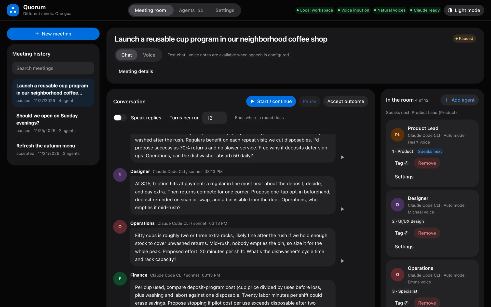
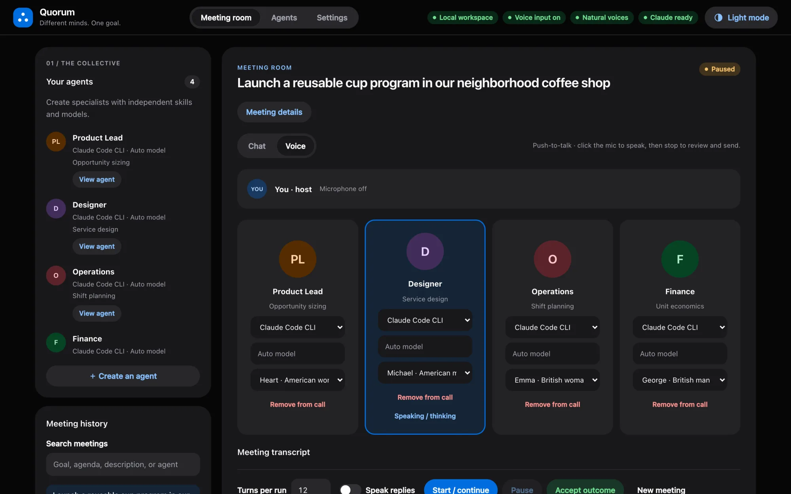
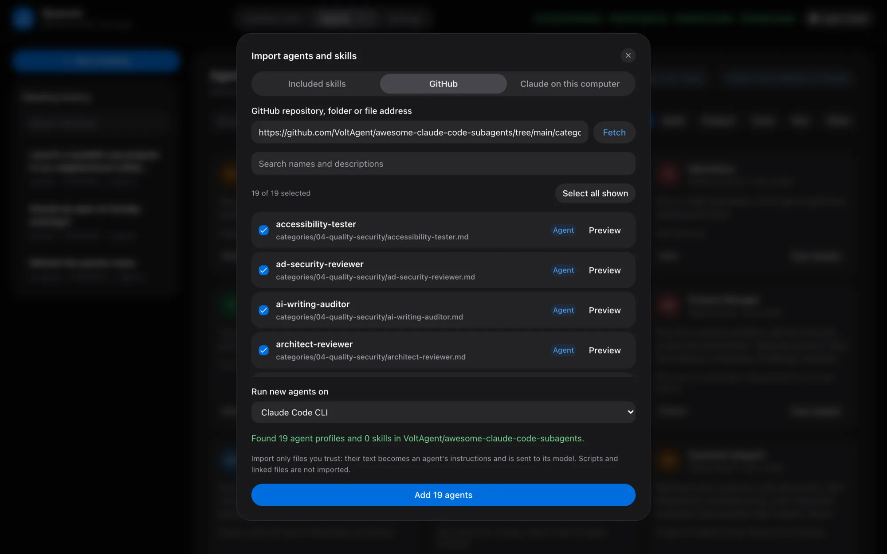
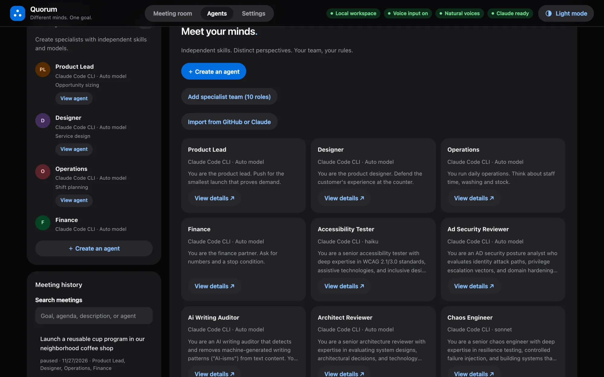

# Quorum

**Your AI team. One conversation. One goal.**

A standalone local-first meeting prototype. Create specialist agents with their own instructions, multiple Markdown skills and model configuration, invite them to a goal-oriented meeting, and let them discuss until you accept the outcome.

## Screenshots

These use a made-up demo meeting with real model replies.










## Website

[docs/index.html](docs/index.html) is a one-page site for Quorum with the screenshots above and the demo meeting as audio. Open the file in a browser, or serve the `docs` folder with GitHub Pages.

## Docker quick start (recommended)

Requirements: Docker Desktop with Compose; allow at least 6 GB RAM for the small default models. Larger models need more memory and disk. The app image includes Node 24; the Mac's Node version does not matter for Docker.

```bash
git clone https://github.com/PerDiemInc/Quorum.git
cd Quorum
cp .env.example .env
docker compose up -d --build
# One-time model download; alternatively use Settings → Download model.
docker compose exec ollama ollama pull qwen2.5:0.5b
```

Open http://127.0.0.1:4710. If another app uses that port, set `QUORUM_PORT=4711` in `.env` and run Compose again. The app accepts only loopback Host headers and same-origin mutations even though its container listens on `0.0.0.0`. Only the app port is published, bound to **127.0.0.1**. Inference services stay on the private Compose network; the app uses `ollama`, `inference`, and `whisper` service DNS names.

Create an agent using **Ollama (local)**, invite it to a meeting, then start the discussion. The built-in Architect and Critic are explicitly labeled demo agents. They do not call an AI model.

### Automatic model selection

Leave an agent's model blank (the default) and Quorum picks one on every turn. The transcript shows the model that answered.

| Provider | Automatic choice |
|---|---|
| Ollama | The largest installed local chat model up to 8 GB, otherwise the smallest. Embedding and cloud models are skipped. |
| OpenAI-compatible | The first non-embedding model the endpoint lists. |
| Claude Code | `sonnet` |
| ChatGPT / Codex | `gpt-6.2-sol` |

Typing a model name pins it. A pinned Ollama model that is no longer installed falls back to the automatic choice. Changing an agent's provider resets it to automatic.

### Dashboard

- **Meeting room:** set a goal, add an optional description and agenda, invite agents or reuse the last team, run or pause turns, add feedback, and accept the outcome yourself. **Remove from call** drops an agent at any point before acceptance, even mid-discussion: its unfinished reply is discarded and the others continue. Earlier messages and the agent library are kept, and a meeting keeps at least one agent.
- **Meeting history:** search by goal, description, agenda, or agent. Reopen a saved room to see its context, participant snapshots, and transcript.
- **Agents:** create specialists, inspect instructions/skills/model/voice, delete from the library, or restore the most recently deleted agent. Existing meetings retain independent participant snapshots. Deleted agents are retained in SQLite for restoration.
- **Settings:** list installed Ollama and compatible endpoint models, check provider access, and install an Ollama model by name. Downloads show progress and errors and survive page navigation. One download runs at a time. If the app restarts, run the pull again; Ollama reuses already downloaded layers. A healthy Ollama process does not imply that any model has been pulled.

### Storage and lifecycle

Named volumes preserve SQLite state (`quorum-data`), Ollama weights (`ollama-models`), optional Hugging Face GGUF downloads (`hf-models`), and optional speech weights (`whisper-models`). The app runs as a non-root user with a read-only root filesystem and a writable `/data` volume. No Docker socket or host credentials are mounted.

```bash
docker compose ps                         # Health status
docker compose logs --tail 100 quorum     # App logs
docker compose down                      # Stop; retain all data/models
docker compose up -d --build              # Rebuild/restart; retain data/models
```

**Do not use `docker compose down -v` unless you intend to delete stored meetings, agents, and model volumes.** Back up the SQLite volume while the app is stopped before resetting it.

### Apple Silicon

Ollama and llama.cpp inside ordinary Linux containers on macOS use the CPU, not Apple's Metal GPU. These Compose services do not request GPU passthrough. Small quantized models work for smoke tests; large models can be slow. See [Ollama's Docker guidance](https://docs.ollama.com/docker). Native macOS Ollama can use Metal, but is a separate deployment choice from this container-first setup.

### Optional Hugging Face inference

```bash
docker compose --profile hf up -d --build
```

This builds a CPU llama.cpp server from a pinned upstream revision, supporting ARM64 and x86 without relying on a registry-hosted server image. The first build and model download take time. The default is Qwen2.5 0.5B Instruct GGUF; override `HF_MODEL_REPO` and `HF_MODEL_FILE` in `.env` for another compatible model. Read its model license before choosing a model for your use. Create an agent with **OpenAI-compatible / Hugging Face** and model `local-hf`. The app uses `http://inference:8080/v1`; the model is downloaded once into its volume. Check `docker compose logs inference` and wait for its health check before using it. Gated model authentication is not configured by this example.

### Optional speech container

Set `WHISPER_URL=http://whisper:8000/v1` in `.env`, then:

```bash
docker compose --profile speech up -d --build
```

The CPU faster-whisper container exposes an OpenAI-compatible transcription endpoint internally. The first transcription downloads `Systran/faster-whisper-tiny.en` into its model cache. Set `WHISPER_REMOTE_MODEL=Systran/faster-whisper-base` for multilingual recognition. Microphone capture still requires browser permission; use loopback HTTP or a secure context. The health check verifies the service, not a completed model download. The app reports transcription errors if the model cannot load.

Speech output uses local browser voices by default. Kokoro remains supported through `KOKORO_URL` in native installs or an explicitly configured compatible service, but is not included in this ARM64 Compose setup. Recording is push-to-talk, not continuous voice activity detection. Optional profiles can run together with `--profile hf --profile speech`.

### Mac Claude Code / Codex access

Docker cannot automatically execute the Mac's CLI binaries or use its login. Settings checks executable presence and authentication in the **app's runtime**, and separately displays an optional timestamped host snapshot:

```bash
npm run check:host
```

Run this on the Mac, not inside Docker. It writes only capability booleans, CLI versions, and the check time into `.quorum/host/access.json`, which is mounted read-only. Re-run after installing a CLI or changing login. Host detection does **not** grant container access. Authentication status is not a guarantee of model entitlement or a successful model call. The check does not issue paid inference requests.

To use host CLIs without the bridge described below, run Quorum natively with Node 24+ and `QUORUM_ENABLE_CLI=1 npm start` (choose a different `PORT` if Docker is running). Install and authenticate `claude` and `codex` first. Their automatic model can be overridden per agent; CLI authentication does not expose a reliable catalog of entitled models. CLI providers generally use cloud inference.

### Validation

```bash
# Native Node 24+:
npm run check
npm test
# Smoke test against running Docker app, after pulling qwen2.5:0.5b:
QUORUM_URL=http://127.0.0.1:4710 npm run smoke
# Run tests without installing Node 24 on the host:
docker run --rm -v "$PWD:/app:ro" -w /app node:24-alpine npm test
```

The smoke test checks app health, origin rejection, model discovery, and an actual Ollama response without modifying agents or meetings. Automated tests cover download errors/concurrency, speech request formatting, Host/Origin restrictions, and SQLite persistence across server restart.

## Run on this Mac with the Docker model services

The server runs natively, so it uses your Claude Code and Codex logins directly (no bridge), while Ollama, llama.cpp and Whisper stay in Docker:

```bash
docker compose stop quorum   # frees port 4711
npm run services             # model services, published on loopback only
npm run start:local          # http://127.0.0.1:4711
```

This needs Node 24+ and Docker; the first run of `npm run services` builds or downloads any missing images. Native data lives in `.quorum/quorum.sqlite`, separate from the Docker `quorum-data` volume. To bring existing data over, stop the `quorum` service and, only if that file does not exist yet, run `docker compose cp quorum:/data/. .quorum/`. To go back to Docker, stop the native server and run `docker compose up -d quorum`; changes made natively are not copied back.

The header shows **Claude ready**, **Claude disabled** or **Claude unavailable**. Claude runs in safe mode (none of your CLAUDE.md, skills, plugins or hooks) with no tools and no saved sessions; set `CLAUDE_BIN` if it is not on the PATH. Each message has a play button that reads it aloud (press again to stop). Playing a message pauses the discussion if **Speak replies** is on.

New agents start on Claude, Codex or Ollama (the first that is connected) with an [automatic model](#automatic-model-selection). With the app running, `npm run check:models` sends one short request to each model in use and to the speech services, and exits non-zero if any fail (set `QUORUM_URL` for a different address). Claude and Codex requests may count against your plan.

The interface is dark by default; **Light mode** in the top bar switches it.

`npm run services` also starts [Kokoro](https://huggingface.co/hexgrad/Kokoro-82M), a neural voice model, when there is a local image with `kokoro-onnx` and its model files in `/app/tts-models` (`ai-models:cpu` by default; set `KOKORO_IMAGE` for another). It is not downloaded for you; without it, Quorum reads with your browser's voices. Every agent gets its own voice, which you can change on its card in a meeting; your messages use a separate one. Markdown symbols are removed before speaking.

## Native quick start

Node.js 24+ is required (built-in SQLite); no npm dependencies. Run `npm start`, then open http://127.0.0.1:4710. State is stored in `.quorum/quorum.sqlite` unless `QUORUM_DATA` is set. Container data lives in a separate Docker volume and is not automatically copied from an existing native checkout.

## Models

- **Ollama:** start Ollama, pull a model (e.g. `ollama pull qwen3:8b`) and create an agent with provider Ollama; the model is chosen automatically. Default endpoint: http://127.0.0.1:11434.
- **Hugging Face / local models:** serve a downloaded compatible model through llama.cpp, LM Studio, vLLM or another OpenAI-compatible chat server. Set `QUORUM_OPENAI_URL=http://127.0.0.1:8080/v1` and use its model identifier.
- **Claude Code / Codex:** install and authenticate the respective CLI yourself, then start with `QUORUM_ENABLE_CLI=1 npm start`. Leave the model blank for the automatic choice, or type a supported model name. These clients usually use cloud inference, not offline inference. Claude receives an empty tool list and empty MCP configuration; Codex uses its read-only sandbox. These settings are not a complete isolation boundary: installed CLI configuration, integrations and read access may still apply. Enable only for trusted agents and skills.
- **Other endpoints:** an OpenAI-compatible provider can use a deliberately configured remote URL and optional `QUORUM_OPENAI_KEY`. This sends conversation and assigned instructions to that service.

## Importing agents and skills

**Included skills.** The [`skills`](skills/README.md) folder holds 249 third-party `SKILL.md` files (MIT and Apache-2.0) gathered from the sources in a Snyk article on skills for founders. Open the import window's **Included skills** tab to add them to an agent; identical copies are listed once. Read the folder's notes on sources, limits and trust.

**Agents → Import from GitHub or Claude:** paste a GitHub address and press **Fetch**. Quorum lists the agent profiles and skills it finds; up to 20 agent profiles are preselected, so **Add** turns them into agents (50 at most in one go). Preview any file first.

- **Agent profiles** are Markdown files with a `name` in their front matter and the instructions below it, the format Claude Code subagents use. Quorum looks in `agents/` folders; in a repository without one, or a folder you link to directly, it checks the other Markdown files. A profile's Claude model is kept when the agent runs on Claude, and skills it names are taken from the same repository. Importing a profile again updates that agent.
- **Skills** are `SKILL.md` files, added to the agent you choose.
- **Claude on this computer** lists `~/.claude/agents`, `~/.claude/skills` and `~/.claude/plugins` (override with `CLAUDE_AGENTS_DIR` and `CLAUDE_SKILLS_DIR`). A Docker install cannot see your home folder, so run natively for this.

Public repositories need no account; set `QUORUM_GITHUB_TOKEN` (a read-only token) for private ones or for a higher request limit. Only Markdown text is imported, up to 32,000 characters per file; scripts and linked files are not, and agents cannot run tools. Imported text becomes an agent's instructions and is sent to its model provider, so import only what you trust. Codex can read local files from its sandbox, so be especially careful with unfamiliar files on Codex agents. Long instructions can overflow a small local model's context.

## Interface

The interface uses [HeroUI v3](https://heroui.com) through its framework-free stylesheet: `public/heroui.css` is `@heroui/styles` 3.2.8 unmodified (Apache-2.0), and `public/styles.css` handles layout. There is no React and no build step. To upgrade, replace the file with `dist/heroui.min.css` from a newer release, keep the header comment, and check every screen.

## Voice meetings

Quorum uses **whisper.cpp** for local speech-to-text and optionally **Kokoro** for speech output.

On macOS install dependencies:

```bash
brew install ffmpeg whisper-cpp
```

Download a compatible whisper.cpp GGML model from the whisper.cpp model repository (e.g. ggml-base.bin or ggml-small.bin for multilingual recognition). Start Quorum with an absolute model path:

```bash
WHISPER_MODEL="$HOME/models/ggml-base.bin" npm start
```

If the binary is not named whisper-cli in your installation, set WHISPER_BIN to its path. FFMPEG_BIN can also be overridden.

Click **Record voice** (microphone permission required), speak, stop the recording, review the local transcription, send it and continue the meeting. Recordings automatically stop after 60 seconds; temporary audio is deleted after transcription. This is push-to-talk, not continuous voice activity detection.

For distinct agent voices, run an OpenAI-compatible Kokoro speech server separately, set `KOKORO_URL=http://127.0.0.1:8880/v1`, and specify a supported voice in each agent (e.g. af_heart). Enable **Speak replies**. Without Kokoro, Quorum uses available local browser speech voices only; availability varies by browser.

## Development

```bash
npm run check
npm test
npm run dev
```

The initial implementation is plain browser JavaScript and Node.js with a single local SQLite state store, HTTP requests, sequential autonomous turns and a per-run turn budget. Only the human can accept a meeting. Pause aborts the active request; model changes are applied between turns. Use one active meeting tab. Stale state saves are rejected with a reload message rather than overwriting another tab.

This prototype does not yet include token streaming, automatic voice interruptions, VAD, speaker selection, tool execution via MCP, private agent memory, native desktop packaging, or automated meeting summaries. Skills are instructions only. Real provider and microphone compatibility require manual testing on the target machine. Never expose the local server to the public internet.

MIT licensed.

## Specialist team and room modes

**Agents → Add specialist team** adds 22 roles in four groups: **Build** (Developer, QA, CISO, Software Architect, DevOps Engineer, Data Analyst, AI Engineer), **Product** (Product Manager, Project Manager, Designer, UX Researcher, Technical Writer), **Grow** (Business Developer, Sales, Marketing, Growth Lead, Customer Success) and **Run** (Customer Support, Operations Lead, Finance Partner, Legal & Privacy, Devil's Advocate). Each has two focused skills. See [role definitions and sources](docs/agents.md). These templates choose their model automatically; pull `qwen2.5:3b` or larger, because the smoke-test model is too small for useful role replies.

Choose **Chat** or **Voice** when creating a meeting, or switch inside the room. Voice mode presents participant tiles, a host microphone indicator and a shared transcript. It enables spoken replies but never starts microphone capture automatically. Click **Turn mic on**, speak, then **Stop & transcribe**, review and send. Recording pauses the agents. This is a Zoom-style room layout with push-to-talk, not WebRTC conferencing, continuous listening, barge-in, or live streaming transcription. Browser-local voice availability varies.

## Optional authenticated Mac CLI bridge

Use the Mac's authenticated `claude` and `codex` without copying their credentials into Docker:

```bash
# On the Mac, from this checkout (Node 20+ for the bridge):
claude auth status
codex login status
npm run bridge:setup
npm run bridge
# In another terminal:
docker compose up -d --build quorum
```

The bridge binds to `127.0.0.1:4712` and permits only the existing Claude/Codex response adapters and capability checks. A random bearer token is stored in ignored `.quorum/bridge/token` and `.env` files with restrictive permissions. The token is available only to the server container, not browser responses. Docker Desktop reaches it through `host.docker.internal`; the models remain on the provider's cloud infrastructure. This is **local CLI access, not local ChatGPT/Claude weights or offline inference**.

Settings performs live bridge authentication checks and enables both CLI providers. With a blank model, Claude agents use `sonnet` and ChatGPT/Codex agents use `gpt-6.2-sol` (see [Automatic model selection](#automatic-model-selection)); type a model name to override. No claim is made that every model is available on every subscription. Requests may count against your plan or incur provider charges. The bridge must remain running; stopping its terminal disconnects CLI access. No startup daemon is installed.

To disable it, stop the bridge, remove `QUORUM_CLI_BRIDGE_URL` and `QUORUM_CLI_BRIDGE_TOKEN` from `.env`, then recreate the app container. To rotate its token, stop the bridge, remove `.quorum/bridge/token`, rerun setup and restart both processes. Never commit or share `.env` or the token. Native CLI configuration may still affect execution; use only trusted role instructions. The bridge is not a general-purpose shell or a complete isolation boundary.
